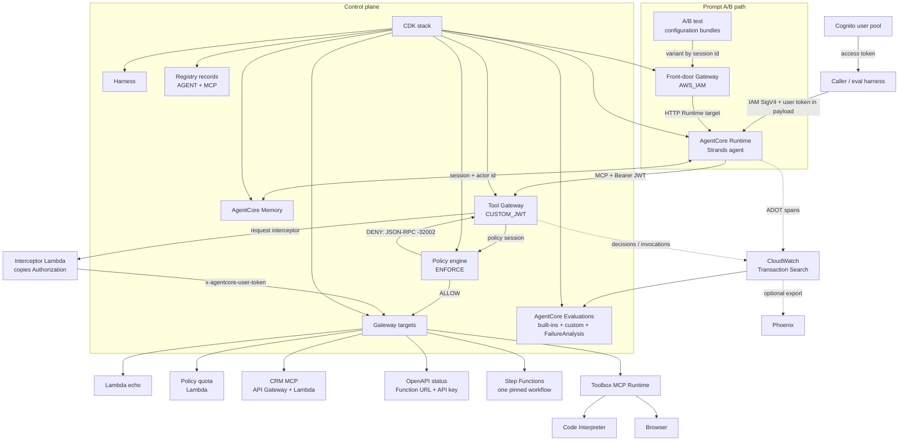

# Architecture

One tool boundary: every tool call goes through AgentCore Gateway. The Runtime
owns the conversation and Memory; it does not import a target endpoint or hold a
target credential. The front-door Gateway is a second, narrower boundary used
only to route the prompt A/B experiment.

## Request path

The front-door Gateway is only on the A/B path. A normal invocation reaches the
Runtime directly with IAM SigV4; the user's Cognito token travels in the payload
and the Runtime presents it to the tool Gateway, which validates it. The Runtime
itself is not JWT-authorized in this design. That is a deliberate scope limit,
not a claim of end-to-end user authentication.

## Why two gateways

| Boundary | Auth | Protocol | Owns |
|---|---|---|---|
| Tool Gateway | Cognito JWT authorizer | MCP | Tool catalog, policy engine, target revocation |
| Front-door Gateway | AWS IAM | HTTP Runtime target | A/B variant assignment only |

The tool Gateway has the only catalog the agent uses. The front door has no
tools and is not an alternate path to a target. A config bundle changes only the
Runtime's `system_prompt`; it does not move the tool boundary.

## Control plane

- **CDK** creates the Runtime, Memory, tool and front-door Gateways, targets,
  Cognito stack, policy engine, evaluators, Harness, online-evaluation config,
  Registry records, and execution roles.
- **Registry publish** is a separate admin step: records are created `DRAFT` and
  submitted for approval by `just registry-publish`. Registry is a searchable
  projection, not a second deployment.
- **Configuration bundles** are immutable service resources created by
  `just prompt-ab`; the A/B test is created and deleted outside CloudFormation.
- **Teardown** removes the stack and then deletes the log groups that
  CloudWatch retains. The shared CDK bootstrap stack and asset stores are
  account-level infrastructure; see [../RESULTS.md](../RESULTS.md).

## What is not in this diagram

- No third-party IdP or hosted consent portal; Cognito is the only user pool.
- No A2A server; the Registry `AGENT` record uses a custom descriptor.
- No Payments path; support operations do not move money.
- No multi-tenant isolation, cross-region replication, or production load
  distribution. Everything is one account, one region.
- The Registry tool list is a projection maintained in the stack, not a live
  Gateway call.

## Evidence map

| Claim | Evidence |
|---|---|
| The agent calls tools only through Gateway | [../RESULTS.md](../RESULTS.md) phase 1: 21 `execute_tool` spans, 0 direct |
| The tool sees the Cognito principal | [IDENTITY.md](IDENTITY.md) |
| Policy denies before the target runs | [POLICY.md](POLICY.md) |
| Heterogeneous targets share one boundary | [TOOL-SURFACE.md](TOOL-SURFACE.md) |
| Registry is discoverable | [REGISTRY.md](REGISTRY.md) |
| Hosting and prompt comparison | [HOSTING.md](HOSTING.md) |
| Service-by-service status and limits | [../COVERAGE.md](../COVERAGE.md) |
