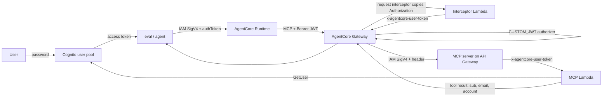

# Identity — a user principal reaches the tool, with Cognito only

**Status 2026-11-01: verified.** The Gateway validates the user's Cognito access
token, a request interceptor forwards that token to the MCP target, and the tool
resolves the same user through Cognito `GetUser`. No consent portal, no
third-party IdP, and no outbound OAuth provider.

## The path



Two credentials, deliberately separate:

- **Inbound** — the user's Cognito access token. The Gateway validates it and
  accepts the MCP call. The Runtime role is not used for tool calls.
- **Target invocation** — the Gateway service role signs the API Gateway request
  (IAM auth). The user token travels in an interceptor-injected header, not as
  the target's `Authorization` header, so SigV4 and the bearer token do not
  collide.

## Why the interceptor

`JWT_PASSTHROUGH` is rejected for both OpenAPI and MCP server targets in this
account, and the hosted consent portal rejects Cognito sign-in. The interceptor
is a supported alternative:

1. The Gateway validates the JWT and invokes the REQUEST interceptor with
   `inputConfiguration.passRequestHeaders=true`.
2. The interceptor reads the incoming `Authorization` value and returns
   `transformedGatewayRequest.headers["x-agentcore-user-token"]`.
3. The target allowlists that header. Gateway-provided headers take precedence
   over client-supplied ones, so a caller cannot set it directly.
4. API Gateway accepts only the Gateway role (`AWS_IAM`), then the Lambda calls
   Cognito `GetUser` with the forwarded token. `GetUser` validates signature and
   expiry; `sub`, `email`, and `email_verified` come from Cognito, not the
   request body.

The interceptor does not log headers.

## Verified

| Fact | Evidence |
|---|---|
| An unauthenticated MCP `tools/list` is rejected with HTTP 401 | `just identity-check` |
| A Cognito access token lists `crm-mcp___getAccount`, `echo-target___echo`, and `policy-quota___spend` | `just identity-check` |
| The agent calls the CRM tool through the Gateway and gets the token subject as `principal`, plus `support-user@example.com` and `ACME-42` | `just identity-check` |
| The assertion uses the access token's `sub`, not a username substring | `evals/identity.py` decodes the token |
| Deleting the `crm-mcp` target removes the tool from the catalog with no Runtime redeploy | `just identity-check --revoke` |
| The target's API Gateway route uses IAM auth and the Gateway role has `execute-api:Invoke` | synthesized policy / deployed route |
| The MCP server only exposes `tools/list` without a token; `tools/call` requires a valid token | Lambda code and target discovery |

The second check matters: target creation calls `tools/list` before a user
request exists, so the MCP server must answer discovery without a token. It
still requires one for `tools/call`, and the target is IAM-only.

## Rejected alternatives

| Mechanism | Result | Consequence |
|---|---|---|
| Hosted consent portal + Cognito | `SignInRejected` after Cognito login | unusable without Entra/Okta |
| Pre-portal 3LO + local BFF | grant stored, but the Gateway's service-linked workload identity cannot see it | no principal at the tool |
| `JWT_PASSTHROUGH`, OpenAPI target | target type rejects it | docs table is wrong |
| `JWT_PASSTHROUGH`, MCP server target | target type rejects it | docs table is wrong |
| OAuth MCP target | target discovery needs a token and returns only the echo tool | no user path |

## Revocation

`just identity-check --revoke` deletes the Gateway target. That is the intended
tool-level control: catalog access changes immediately, without redeploying the
Runtime or the agent. It does **not** revoke already-issued Cognito access
tokens; those remain valid until expiry, and Cognito does not offer synchronous
access-token revocation. The demo should say "tool revoked" rather than "user
logged out."

## Reproduce

```sh
export AWS_PROFILE=arch AWS_REGION=us-east-1
just deploy
export IDENTITY_TEST_PASSWORD=...        # stays in the shell/LOCAL.md
just identity-setup                      # test user only
just identity-check                      # 401, catalog, principal
just identity-check --revoke             # also delete the target and re-check
```

`identity-setup` is idempotent. It creates or resets the test user and prints
the pool/client ids.

## Scope notes

- The Runtime still uses IAM SigV4 for its own `/invocations` endpoint; the user
  token travels in the payload and is forwarded to the Gateway. That means the
  Runtime trusts its caller to supply a token, while the Gateway is the component
  that validates it. A stricter design puts a JWT authorizer on the Runtime too
  and forwards the `Authorization` header.
- The target API is reachable only with the Gateway role's IAM credentials; the
  user token header is not a public bearer gate.
- No secrets, account ids, or ARNs are committed.
