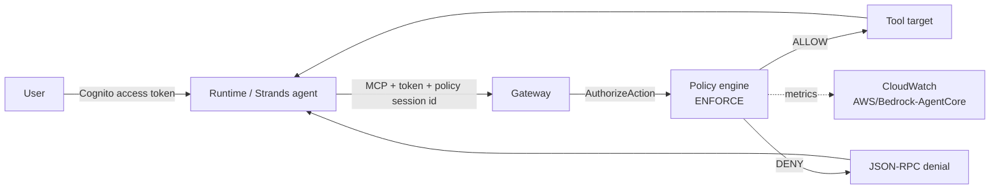

# Policy in AgentCore — enforced limits outside the agent

Measured 2026-11-02 on the current tree. The Gateway evaluates Cedar/Dogwood
policies before a tool runs; the agent cannot talk its way past a deny. No
account id or ARN is committed — the stack templates the Gateway ARN.

## What is enforcing what



| Policy | Language | Rule | Why |
|---|---|---|---|
| `gateway_baseline_permit` | Cedar | permit every action on this Gateway | Default-deny would otherwise hide the whole catalog. The limits are the forbids. |
| `quota_limit` | Cedar, generated from natural language | forbid `policy-quota___spend` when `context.input.amount > 100` | Proves a parameter rule and an over-limit deny. |
| `crm_once_per_session` | Dogwood (temporal) | forbid a second `crm-mcp___getAccount` in the same policy session | Proves history-dependent enforcement, not just the current request. |

## Policy session

The Runtime generates one header per invocation:

```
x-amzn-bedrock-agentcore-policy-session-id: <session id>
```

`agent/app.py` passes it on the MCP client, so every tool call in one Runtime
session shares the temporal history. The Gateway accepts only `[A-Za-z0-9-]`,
1–128 characters; unsafe session ids are replaced by a stable hash rather than
truncated. The session is bound to the authenticated Cognito principal by the
Gateway.

The Gateway execution role grants `AuthorizeAction`, `PartiallyAuthorizeActions`,
`GetPolicyEngine`, and `GetWorkloadAccessToken`. Without the first three, an
attached engine denies everything; without the WAT permission, temporal
evaluation fails at token mint.

## Natural-language authoring

`StartPolicyGeneration` turned this prompt into the committed `quota_limit`
statement:

> Deny any request to the policy-quota___spend tool when the amount argument is
> greater than 100. The deny applies to every authenticated caller and only to
> this gateway.

Generated output:

```cedar
forbid (principal, action == AgentCore::Action::"policy-quota___spend",
        resource == AgentCore::Gateway::"<gateway-arn>")
when { context.input.amount > 100 };
```

The statement is committed instead of generated during deploy so the stack is
reproducible and reviewable. The prompt lives in `NL_POLICY_PROMPT`; the
generation asset had no findings.

## Evidence

`just policy-check` produced:

| Check | Observed |
|---|---|
| Quota boundary | amount `100` allowed; `101` denied |
| Temporal boundary | first CRM lookup allowed; second in the same session denied |
| Agent behaviour | "Policy refused the action... blocked by the policy quota system" — no tool error surfaced |
| CloudWatch | `DenyDecisions` for `quota_limit` and `crm_once_per_session`; `AllowDecisions` for the baseline permit |

Denials are HTTP 200 with a JSON-RPC error code `-32002` and message
`Tool Execution Denied: ... policy enforcement [policy-id]`. That is why the
agent must translate it into a refusal: the transport is not an HTTP failure.

## Limits of this evidence

- **One caller, one account, one region.** The policy engine and temporal
  sessions were exercised in `us-east-1`; cross-account and cross-Region
  temporal propagation are out of scope (and documented as unsupported).
- **The quota is one tool.** `policy-quota___spend` exists to make the parameter
  rule observable; it is not a production billing control.
- **Temporal policies are cooperative.** The caller supplies the session id, so
  a caller that starts a new session resets the history. This is a loop guard,
  not an anti-abuse control.
- **Two policies ignore static-analysis findings.** The baseline permit is
  intentionally broad, and the temporal forbid is intentionally session-wide;
  `FAIL_ON_ANY_FINDINGS` flags both. The findings are recorded in the stack
  comments rather than suppressed silently.

## Reproduce

```sh
export AGENTCORE_GATEWAY_URL=...   # `just deploy` outputs
export AGENTCORE_GATEWAY_ID=...
export POLICY_ENGINE_ARN=...
export AGENTCORE_RUNTIME_ARN=...
export COGNITO_USER_POOL_ID=...
export COGNITO_CLIENT_ID=...
export IDENTITY_TEST_PASSWORD=...
just policy-check
```
