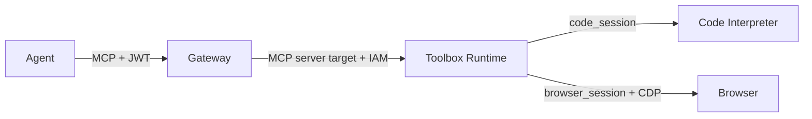

# Tool surface - one Gateway, several target types

**Status 2026-11-02: deployed and measured, then torn down.** The acceptance
condition for this phase is one call through each target type, attributed in
Gateway records. The committed evidence is in `RESULTS.md`; this file records
the design and its limits.

## The surface

| Target | Type | Callable tool | What it proves |
|---|---|---|---|
| `echo-target` | Lambda | `echo-target___echo` | A Lambda tool is reachable only through Gateway |
| `crm-mcp` | MCP server | `crm-mcp___getAccount` | An MCP server target receives the caller's Cognito principal |
| `openapi-status` | OpenAPI | `openapi-status___fetchStatus` | An OpenAPI target with API-key outbound auth |
| `workflow` | Connector (`states`) | `workflow___StartExecution` | A Step Functions workflow pinned to one state machine |
| `toolbox` | MCP server | `toolbox___execute_python`, `toolbox___browse_page` | Code Interpreter and Browser stay behind the same auth boundary |

All tools are listed from the Gateway with a Cognito access token. The
policy engine is attached to the Gateway, so its baseline permit and forbids
apply to the new tools as well.

## OpenAPI target


The key is generated by CloudFormation and stored in AgentCore Token Vault. The
Lambda reads the same secret and compares the header before returning
`openapi-target-ok`. The Function URL is public only in the sense that it exists;
a request without the key gets a 401. No literal key is committed.

## Step Functions connector

The target uses `connectorId: "states"` and pins `StartExecution` to one Standard
state machine. The Gateway removes `stateMachineArn` from the tool schema, so the
agent cannot choose another workflow. The Gateway role has `states:StartExecution`
scoped to that state machine; the workflow role is separate and calls nothing.

## Code Interpreter and Browser

Neither built-in tool is exposed directly to the agent. A small MCP Runtime
(`agentcore_toolbox`) wraps them:



The toolbox exposes exactly two operations: `execute_python(code)` and
`browse_page(url)`. It returns text, not credentials or live-view URLs. Browser
navigation is a single CDP `Page.navigate` followed by a title/text read; it is a
smoke test of the managed browser, not a browser-automation agent.

## Reproduce

```sh
export AWS_PROFILE=arch
export AGENTCORE_GATEWAY_URL=<gateway url>
export COGNITO_USER_POOL_ID=<pool id>
export COGNITO_CLIENT_ID=<client id>
export IDENTITY_TEST_PASSWORD=<not committed>
just tool-surface
```

`tool-surface` prints the catalog, invokes one tool per target, and reads the
`AWS/Bedrock-AgentCore` metrics for the Gateway. It is deliberately separate from
`just eval`: the target calls are the proof of heterogeneous routing, while the
evaluated sessions exercise the agent.

The 2026-11-02 run listed seven tools and passed six calls. CloudWatch showed
`Invocations` with `TargetType=CONNECTOR` and `TargetType=LAMBDA`, plus per-tool
`Name` dimensions for `workflow`, `openapi-status`, `toolbox` and the older
targets. The toolbox image pins `mcp==1.28.1`; `mcp` 2.x removed the FastMCP
module this server uses.

## Limits

- One caller, one region, one invocation per target. This is a routing check,
  not a load or failure-distribution test.
- The Browser check uses `https://example.com`; it does not test authenticated
  sites, downloads, or multi-step interactions.
- Gateway metrics are batched at one-minute intervals. `list_metrics` is
  account-wide and can include metrics from earlier deployments; the current
  run's tool names and the calls themselves are the primary evidence.
- The policy baseline applies to the new tools, but this phase adds no
  target-specific policy beyond the existing quota and temporal rules.
